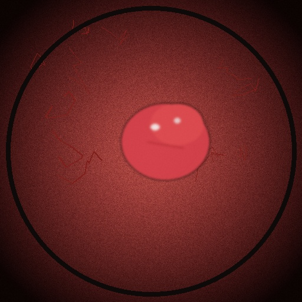

# 🩺 EndoVision AI — Endoscopic Polyp & GI Lesion Semantic Segmentation

A clinical-grade deep learning web application built with **Flask** and an interactive, glassmorphic UI for pixel-level endoscopic colorectal polyp delineation (Kvasir-SEG dataset, VGG-16 U-Net architecture).



---

## 🌟 Key Feature

### 🖥️ Awesome Frontend & Visualizer
- **Interactive Before/After Split Reveal**: Smooth dragging divider slider comparing the raw colonoscopy video frame directly against the AI lesion segmentation overlay.
- **6 Multi-Angle Visualization Modes**:
  - `Split Reveal`: Drag comparator with neon divider handle.
  - `Overlay Blend`: Semi-transparent alpha blend with custom color palette.
  - `Contours & Bounding Box`: Glowing lesion border + surgical target box and centroid crosshair.
  - `Probability Heatmap`: Jet / Turbo colormap displaying model confidence gradients.
  - `Binary Mask`: High-contrast ground-truth delineation mask.
  - `Quad Grid`: 4-view synchronized comparison matrix.
- **Customization Controls**:
  - 6 Medical color palettes: Emerald Neon, Laser Red, Cyber Cyan, Amber Gold, Electric Violet, Hot Magenta.
  - Real-time Opacity slider (10% – 100%).
  - Decision threshold sensitivity slider (0.20 – 0.80).
  - Zoom & Pan controls with Fullscreen Theater inspection mode.

### 🧪 Intake & Presets
- **1-Click Clinical Preset Gallery**:
  - *Sessile Adenoma* (Paris Type Is)
  - *Pedunculated Polyp* (Paris Type Ip)
  - *Flat Dysplastic Lesion* (Paris Type IIa)
  - *Normal Healthy Mucosa* (Control / Negative)
- **Flexible Ingestion**:
  - Drag-and-drop zone with animated scanning beam.
  - Direct clipboard paste support (`Ctrl+V` / `Cmd+V`).
  - Standard file browser (JPG, PNG, WEBP).

### 📊 Clinical Intelligence & Diagnostics Dashboard
- **Detection Status**: Instant color-coded positive/negative alert banner.
- **Confidence Meter**: Model prediction confidence percentage with animated track.
- **Morphometric Metrics**:
  - Lesion surface area coverage (% of field of view and exact pixel count).
  - Paris Classification estimation (Type Is, Type Ip, Type IIa, None).
  - Clinical risk stratification tier (Tier 0 to Tier 3).
  - Real-time inference latency benchmark (in milliseconds).
- **Procedural Decision Support**: Actionable clinical guidance (e.g., Cold snare polypectomy, EMR, or chromoendoscopy margin assessment).

### 📑 Reporting & Simulation
- **Printable Clinical Examination Report**: One-click hospital report generator formatted with patient ID, date, image evidence, quantitative metrics, and doctor signature blocks ready to print or save to PDF.
- **Real-Time Video Stream Simulator**: Simulates 24 FPS live colonoscopy feed cycling across endoscopic views with animated recording beacon.
- **Export Capabilities**: 1-click download of composite overlay (PNG), binary mask (PNG), and clinical JSON telemetry.

---

## 🚀 Quick Start

### 1. Install Dependencies
```bash
pip install -r requirements.txt
```

### 2. Run the Flask Web Application
```bash
python app.py
```

Open your browser and navigate to:
```
http://127.0.0.1:5001
```

---

## 🏗️ Architecture & Model Specs

- **Model**: U-Net Encoder-Decoder with Skip Connections
- **Encoder**: ImageNet pre-trained VGG-16 backbone
- **Loss Function**: Binary Cross-Entropy + Soft Dice Loss
- **Benchmark Evaluation (Kvasir-SEG Test Split)**:
  - **Mean Dice**: `0.8915`
  - **Polyp IoU**: `0.8301`
  - **Mean IoU**: `0.8931`

---

## 📁 Project Directory Structure
```
├── app.py                      # Flask backend API & routes
├── requirements.txt            # Python dependencies
├── README.md                   # Documentation & guide
├── polyp_seg/
│   ├── __init__.py
│   ├── model.py                # VGG16-UNet PyTorch architecture
│   ├── processor.py            # Image processing, jet heatmap, overlays, contours
│   └── predictor.py            # Unified inference engine with hybrid fallback
├── static/
│   ├── css/
│   │   └── style.css           # Glassmorphism dark theme, split slider, clinical styling
│   ├── js/
│   │   └── app.js              # Split slider, view modes, drag-and-drop, export
│   └── samples/                # Curated endoscopic colonoscopy sample frames & masks
└── templates/
    └── index.html              # Modern, responsive HTML5 layout
```